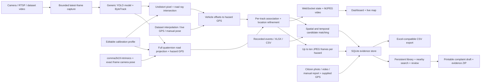

# RoadWatch

A local road-hazard dashboard built around your `best.pt` YOLO model, supplied RoadSens recordings, and comma2k19. It shows tracked detections, estimated road distance, projected hazard GPS coordinates, an updating map, and associations with recorded anomaly events or uploaded XLSX/CSV references. A persistent hazard library stores up to ten evidence frames per hazard, accepts GPS-tagged citizen submissions, and prepares downloadable municipal complaint drafts.

## Run

From PowerShell in `E:\IS`:

```powershell
.\.venv\Scripts\python.exe -m pip install -r requirements.txt
.\.venv\Scripts\python.exe run_roadwatch.py
```

Open <http://127.0.0.1:8000>. Alternatively run `powershell -ExecutionPolicy Bypass -File .\start_roadwatch.ps1`. The launcher creates the virtual environment when absent. The app stays on this computer. Stop the server with Ctrl+C. Use `--port 8001` if 8000 is occupied.

## First session

1. Select a dataset and recording with video. RoadSens recording **33** contains a model-detected pothole near 2 seconds; recording **34** has two annotated pothole events. RoadSens GPS follows video time plus the editable synchronization offset. comma2k19 uses its native frame timestamps and synchronized camera poses.
2. In **Camera calibration**, enter measured intrinsics, distortion, image dimensions, camera height and mount angles for RoadSens or your own camera. Height is above the road; forward/right offsets locate the camera relative to the GNSS antenna. comma2k19 supplies its own intrinsic profile and frame attitude, while the editable height remains an assumption. Estimates remain **provisional** until independently measured and validated.
3. To estimate intrinsics, upload at least five distinct checkerboard views (10–20 are preferable). Enter inner corner counts and square size in meters. Review the reprojection error, apply the results, and separately measure the mount pose. Checkerboard calibration does not measure camera height, pitch, heading or GPS alignment.
4. Save settings while the session is stopped. Start detection in **Live monitor**. Bounding boxes show the model label, confidence, tracker ID, and estimated ground distance. The map adds markers when synchronized position and heading are available. Click a video point in calibration to inspect the projection.
5. Import your XLSX/CSV anomaly log in **Dataset & records**. Header aliases work automatically; optional mappings use canonical fields such as `latitude`, `longitude`, `hazard_type`, `recording_id`, and `time_s`. Export hazard results as an Excel-compatible CSV.
6. Open **Hazard library** to review photographs from every session and edit complaint details. Use its nearby search with browser location or entered coordinates. **Recover missing photos** extracts evidence from available original recordings for older records.
7. Use **Report a hazard** for GPS-tagged photo/video detection or a manual report. **Detection replay** plays or seeks a dataset/uploaded video with YOLO bounding boxes, a synchronized hazard log and automatic evidence capture.

The supplied model was inspected and contains **Longitudinal, Transverse, Alligator, Pothole**. It is not trained to detect bumps. A different local Ultralytics model can be selected from the UI, and its actual classes are read at session start.

## Saved evidence, citizen reports and complaints

Hazard records and JPEG evidence are stored in **`roadwatch_data/roadwatch.sqlite3`**. SQLite enforces a maximum of **10 frames per hazard**, including concurrent writes. Tracked replay/live detections save frames at least 0.5 seconds apart; observation counts may be higher than saved-frame counts. The library persists across server restarts. Uploaded originals remain under `roadwatch_data/uploads/` so video replay can read them; JPEG evidence is stored as database BLOBs.

Photo submissions accept up to **25 MiB / 24 megapixels**. Video submissions accept up to **250 MiB / five minutes**, with at most **900 sampled inference frames**. Enter coordinates and identify whether they locate the hazard itself or the camera. A single camera coordinate is only an approximate location proxy and applies to the whole upload. For a moving video, optionally supply timestamped GPS JSON; the app rejects gaps over three seconds and does not extrapolate. Uploaded GPS does not establish a camera calibration or a measured hazard distance. Manual reports support classes outside the model and do not pretend to be AI detections. A photo/video with no supported detection creates no invented hazard.

Open a library record to add the responsible authority, street/landmark, description, user-assessed priority and optional reporter details. Set its local status to **Open**, **Reported** or **Resolved**. **Print / save PDF** opens a printable complaint draft; **Download evidence package** returns a self-contained ZIP with the draft, JPEGs, coordinates and machine-readable evidence. Review historical dataset evidence and current road conditions before filing. Nothing is automatically submitted or sent to a municipality.

Detection replay runs YOLO on each newly visited video frame, draws class/confidence boxes and saves the hazard and capped evidence images. Revisiting an analyzed frame reuses its persisted detections and does not increment observations or log duplicate frames. Play/pause, seeking, restart and speed controls remain available; the HEVC-compatible preview targets up to five analyzed frames per second without audio, with actual speed limited by inference/decoding. Analysis is reused across reloads when source, model and settings match. Original video downloads remain available.

The library leads with photographs and offers filters for records with or without images. Missing images can be recovered from retained source media. Recovered frames are marked as reconstructed; any boxes inferred during recovery are current predictions, not original tracker evidence. The original hazard class, GPS and complaint details are preserved. Manual reports without media and deleted source videos cannot supply a photograph.

See [docs/HAZARD_LIBRARY.md](docs/HAZARD_LIBRARY.md) for workflows, GPS-track examples, storage and API details.

## comma2k19

In **Dataset & records**, choose comma2k19 to browse completed segments. The download panel shows progress and supports **Pause download** and **Resume full download**; partial files are retained. The official example is available separately from the full release, which is approximately 100 GB before allowing for extraction space. Newly completed recordings appear after refresh; stop an active session before refreshing the list. A background download continues independently of the dashboard server.

To start or resume from PowerShell:

```powershell
.\.venv\Scripts\python.exe scripts\download_comma2k19.py --scope all --workers 3
```

Segments are stored under `datasets/comma2k19/`. Select **dataset GPS** for replay. Published intrinsics are **1164 × 874**, `fx=fy=910`, `cx=582`, `cy=437`. Exact `frame_times` align each decoded frame to its camera ECEF position and Hamilton quaternion; the full camera attitude is used for road projection. Selecting comma2k19 preserves the saved RoadSens/own-camera lens profile. Its native pose already refers to the camera, so manual mount angles and antenna offsets are not applied again.

Camera height starts at an editable **1.4 m assumption**, zero distortion is assumed, and the ground model is locally flat. Distance and hazard GPS remain provisional. A GNSS-only fallback can show the track but cannot provide camera-pose hazard localization. No per-frame accuracy or total hazard accuracy is invented.

comma2k19 has **no hazard ground-truth labels** in this integration. YOLO outputs are predictions; missing labels do not imply a hazard-free road. RoadSens annotations are kept separate. A sample replay produced four geolocated crack predictions from eight detections; this verifies the replay/localization pipeline, not detection accuracy. See [download and dataset details](docs/COMMA2K19.md) and [camera/pose conventions](docs/COMMA_GEOMETRY.md).

## Camera and live GPS

Choose a webcam index, local video within the project folder, or RTSP/HTTP camera stream. Choose **live GPS** and supply timestamped latitude, longitude, heading and horizontal accuracy through the UI/browser or `POST /api/pose`. A camera alone cannot measure global coordinates. Browser GPS often lacks heading when stationary; enter heading explicitly or use a GNSS/IMU bridge. Live GPS expires after the configured age. **Manual GPS** is a fixed, explicitly configured vehicle pose, useful for a stationary camera; it must be updated for vehicle motion.

```json
{"latitude":24.375702,"longitude":88.622582,"heading_deg":90,"accuracy_m":3.8}
```

Heading is clockwise from true north. Include optional `timestamp_ms` (Unix milliseconds) to validate the original fix age; browser geolocation supplies this automatically. Without it, freshness is measured from receipt. Bridge devices must send fresh, time-aligned fixes. Historical file replay should use dataset GPS and a measured time offset. For live video, only the newest captured frame is processed, preventing a growing inference queue. Large frames are uniformly resized to a maximum dimension of 1280 before processing and display, with matching camera-matrix scaling. Actual FPS and inference time are shown; throughput depends on the camera, image size and GPU. `auto` selects available inference hardware; CPU is also supported.

## Data and accuracy

The RoadSens audit found **102 recording folders, 81 videos, and 688 button-press events** (292 potholes and 396 bumps). No Excel workbook was present. The existing anomaly records are CSV files. Original `Annotation.csv` events are authoritative; isolated sensor windows repeat labels across rows and must not be counted as independent hazards. Downloaded comma2k19 segments add playable recordings without adding reference hazard events.

RoadSens reference markers are **vehicle locations at annotation time**, interpolated from sparse GPS. They are not surveyed pothole centers. Associations use compatible hazard class, recording identity when supplied, spatial radius, and time tolerance within the same recording. Uploaded records without recording IDs can match spatially; explicit conflicting recording IDs are rejected. A candidate association does not establish detection accuracy.

Distance uses undistorted camera rays intersected with a locally flat road. It is suitable for visible road-surface hazards, including the crack classes supported by the model. Slopes, suspension motion, incorrect mounting angles, camera stabilization/cropping, or a bounding-box anchor off the road can bias estimates. A box bottom measures the selected surface anchor, not pothole depth or necessarily its center. Aspect-ratio mismatches, near-horizon rays, GPS gaps and missing heading suppress invalid positions. Reported GNSS accuracy is retained; absolute hazard error is not measured and is not reduced by averaging frames.

Each confirmed ByteTrack identity produces one persisted hazard per session. The strongest-confidence class observation labels the track; class changes are retained and shown as uncertainty rather than creating duplicate markers. Multiple observations refine its location, with large position jumps rejected. IDs are local to a session; this is not a global cross-vehicle deduplication system. Reference markers and detected hazard markers use distinct map layers. OpenStreetMap tiles require internet; Leaflet itself is bundled locally. The dashboard exports the current session when one is selected; `/api/export.csv` without a session filter exports all saved sessions.

## Architecture and extension points



| Module | Responsibility |
| --- | --- |
| `roadwatch/geometry.py` | Validated camera model, checkerboard calibration, projection, geodetic offsets |
| `roadwatch/datasets.py` | RoadSens discovery, sparse GPS interpolation, event references, workbook ingestion, matching |
| `roadwatch/catalog.py` | Unified dataset selection, source-specific calibration and reference routing |
| `roadwatch/comma_dataset.py` | Unlabeled comma2k19 segments, exact frame times, ECEF/quaternion interpolation, bounded map tracks |
| `roadwatch/comma_geometry.py` | Published camera intrinsics, full camera-pose road projection and WGS84 coordinates |
| `roadwatch/comma_download.py` | Resumable background download, integrity checks, extraction, pause/resume and progress |
| `roadwatch/dataset_paths.py` | Segment discovery that prunes telemetry and temporary directories |
| `roadwatch/engine.py` | Video capture, YOLO/tracker lifecycle, localization and track evidence |
| `roadwatch/config.py` | Validated settings and atomic profile persistence |
| `roadwatch/storage.py` | SQLite sessions, hazard records, capped JPEG BLOB evidence, review metadata and imported references |
| `roadwatch/library_api.py` | Persistent hazard queries, nearby search, evidence gallery and review endpoints |
| `roadwatch/complaints.py` | Escaped, self-contained printable complaint drafts and evidence ZIP packages |
| `roadwatch/submissions.py` | Bounded photo/video detection jobs, manual reports and explicit uploaded GPS provenance |
| `roadwatch/replay.py` | Source video metadata, HEVC-compatible frame replay, seeking and original video download |
| `roadwatch/replay_detection.py` | Annotated on-demand YOLO replay, persistent frame predictions, association and idempotent logging |
| `roadwatch/evidence_recovery.py` | Background recovery of missing source photographs with explicit reconstruction provenance |
| `roadwatch/app.py` | HTTP API, WebSocket and MJPEG endpoints |
| `roadwatch/static/` | Responsive browser UI and bundled map library |

Runtime settings and results are stored in `roadwatch_data/`. Dataset and model source files are preserved. Instantiate `UnifiedCatalog` with a different project root to change the data location. Additional dataset providers can supply synchronized poses, frame timestamps, calibration and references through the catalog interface. For depth/stereo or a sloped-road model, replace the relevant projection while retaining its valid/reason contract. RoadSens conventions are detailed in [docs/GEOMETRY.md](docs/GEOMETRY.md) and [docs/DATASET.md](docs/DATASET.md); comma2k19 is documented in [docs/COMMA2K19.md](docs/COMMA2K19.md) and [docs/COMMA_GEOMETRY.md](docs/COMMA_GEOMETRY.md).

## Verification

```powershell
.\.venv\Scripts\python.exe -m pytest -q
```

Tests cover known projection geometry, distortion, rotations, GPS gaps and heading interpolation, annotation deduplication, XLSX/CSV reference parsing, association gates, invalid settings, API behavior and persistence. comma2k19 checks also cover exact frame timing, quaternion/ECEF projection, calibration isolation, absent labels, GNSS fallback, discovery and resumable downloads. Library checks include database migration, concurrent evidence caps, nearby sorting, review persistence, complaint escaping and packaged evidence. Camera accuracy requires a measured profile and an independent surveyed reference.

Implementation references: [OpenCV camera calibration](https://docs.opencv.org/4.x/d9/d0c/group__calib3d.html), [Ultralytics tracking](https://docs.ultralytics.com/modes/track/), [Leaflet](https://leafletjs.com/), and [OpenStreetMap attribution](https://www.openstreetmap.org/copyright).
